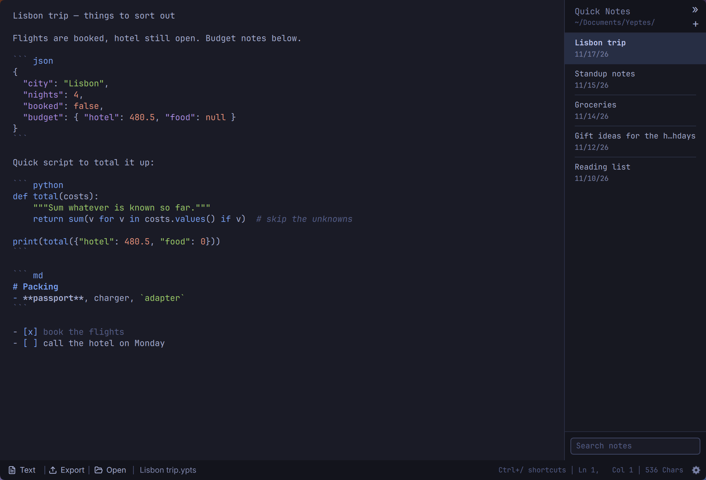
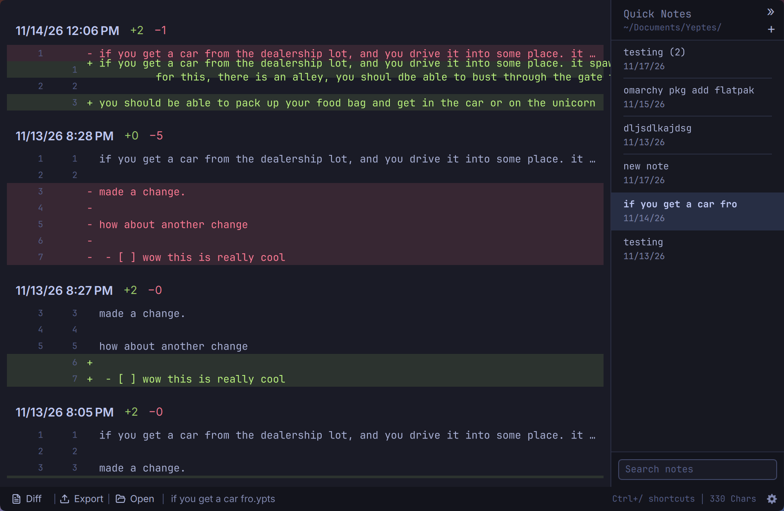

# Yeptes



A plain text notepad for Omarchy. It opens any UTF-8 text file, anywhere on
the drive, and shows it seven ways. The view is picked from the button at the
left of the status bar, or with its shortcut:

| View | What it does |
|------|--------------|
| Text | Monospace editing. This is where you write. |
| Markdown | The note rendered as Markdown. |
| JSON | A tree with objects and arrays that fold; values are edited in place. |
| HTML | The note rendered as a static page. Scripts are removed and nothing is fetched from the network. |
| Table | CSV or TSV as a grid; cells are edited in place. |
| Code | The text editor, with the whole file colored in one language. |
| Diff | What changed since the last save, and for a Yeptes note every saved change before that. |

The Code view takes its language from the file's extension (`.py`, `.rs`,
`.json`, …). The button beside the view's name in the status bar picks
another, or **Plain text**, for a note or a file the extension says nothing
about.

In the text view, clicking the box of a checklist line (`- [ ]`) ticks it:
the space becomes an `x`, and back again.

## Yeptes notes

A `.ypts` file is plain text with one extra: in the text view, a fenced block
is colored in its language.

````text
``` json
{ "colored": true }
```
````

Languages: bash, c, cpp, csharp, css, go, html, java, javascript, json,
kotlin, lua, markdown, php, python, ruby, rust, sql, swift, toml, typescript,
xml, yaml, plus the usual short names (`js`, `ts`, `py`, `c++`, `c#`, `sh`,
`md`, `yml`, `rs`). Each language's rules are read the first time a fence
names it. A new, unsaved note is a Yeptes note; other files stay plain.

A note also keeps its own history. Each time a changed note is saved, the
lines that changed are appended to the end of the file, after a marker line,
one JSON object per save. The Diff view reads them back, newest first. They
never show in the text, and **Export** (`Ctrl+E`) writes a copy of the note
without them.



## Quick notes

Notes saved without picking a place go to `~/Documents/Yeptes/`, and the panel
on the right lists them, newest first. Click one to open it, drag them into
your own order, and right-click to move one to the trash. The search box at the
bottom shows only the notes whose name or text contains what you type. The `+`
starts a new note, and `»` folds the panel into a slim rail.

Emptying a quick note of all its text and then leaving it asks whether to
delete the note or revert it, rather than saving it blank.

## Shortcuts

Letters and Space belong to the text, so the app's own keys carry Ctrl.

| Key | Action |
|-----|--------|
| `Ctrl+N` | New note |
| `Ctrl+O` | Open a file |
| `Ctrl+S` | Save |
| `Ctrl+Shift+S` | Save as |
| `Ctrl+E` | Export a note without its history |
| `Ctrl+1` … `Ctrl+7` | Text, Markdown, JSON, HTML, Table, Code, Diff view |
| `Esc` | Back to the text |
| `Ctrl+Z` / `Ctrl+Shift+Z` | Undo / redo |
| `Ctrl++` `Ctrl+-` `Ctrl+0` | Larger, smaller, normal text |
| `Alt+Z` | Wrap long lines |
| `Ctrl+/` or `F1` | Show the shortcuts |
| `Ctrl+Q` | Quit (asks first when there are unsaved changes) |

In the JSON view:

| Key | Action |
|-----|--------|
| `↑` `↓` | Move between values |
| `←` `→` or `Space` | Fold and unfold |
| `Enter` | Edit the value (Enter again to keep it, Esc to drop it) |
| `E` / `C` | Expand all / collapse all |

In the Table view, the arrow keys move between cells and `Enter` edits one.

You can also drop a file on the window, or pass one on the command line.

## Careful with your files

- Saves are atomic: the file is written beside the target and renamed over it.
- Line endings (LF or CRLF) and a byte order mark are written back as found.
- Files that aren't UTF-8, or are over 16 MB, are refused with a message
  rather than opened and damaged.
- Editing a value in the JSON view or a cell in the Table view replaces only
  that value's characters; key order, spacing, and everything else in the
  file stay as written.

## Command line

```sh
yeptes [open] [file]            # open the window
yeptes check <file> [--json]    # does it open, does the JSON parse, which fences are colored
yeptes skill install            # install a short skill for coding agents
```

`check` exits 1 with the problem on stderr.

## Install

Once it is in the Omarchy package repository:

```sh
omarchy-pkg-add yeptes
```

Until then, or to run your own changes, build it from source with
`bin/install` (below).

## Build

```sh
bin/build      # qmake6 + make into build/yeptes
bin/test       # the Qt Test suite, offscreen
bin/install    # builds the Arch package and installs it (app launcher entry included)
```

`packaging/omarchy-pkgs/` holds the recipe for the Omarchy package
repository, which builds from a tagged GitHub release.

Needs `qt6-base`, `qt6-declarative`, `qt6-wayland`, and `xdg-desktop-portal`,
all part of Omarchy. The window follows the Omarchy theme's colors (the editor
too, until you pick its colors in Settings), Hyprland's corner rounding, and the language picked under Setup > Language (English, Danish,
German, Spanish, and French so far).

## License

MIT. The theme, translator, and portal file picker are adapted from Omacut,
Monologue, and Hype by David Heinemeier Hansson.
